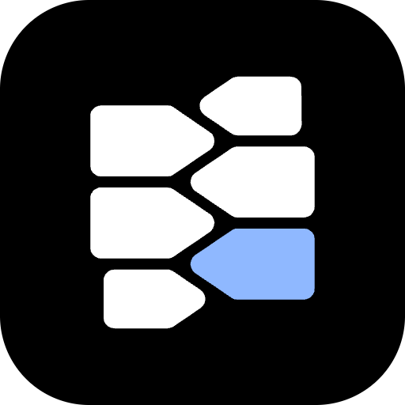

<p align="center">
  <a href="https://aginery.com"></a>
</p>

<h1 align="center">Agent Machinery</h1>

<p align="center"><strong>Roll out AI tools across your team from one MCP gateway.</strong></p>

<p align="center">Give employees and headless agents the tools they need, with access controls you manage centrally.</p>

<p align="center">
  <a href="https://aginery.com">Explore Agent Machinery</a> · <a href="#install">Install the plugin</a>
</p>

## Why Agent Machinery?

| What you get | How it helps |
| --- | --- |
| **One connection for your tools** | Connect Cursor, Claude Code, or Codex to `https://aginery.com/mcp` instead of configuring each upstream MCP server in every harness. |
| **Access your team controls** | Decide which tools each person or workload can use. Agent Machinery handles upstream sign-in and keeps those credentials out of the plugin. |
| **Human and headless access** | Employees sign in with their own accounts. Automated jobs use dedicated workload identities instead of shared human logins. |

This plugin connects your harness to the hosted gateway. It doesn’t install a local server or bundle credentials.

## Install

### Cursor

In Cursor, open **Customize → Plugins** and install **Agent Machinery** once it’s available in the Cursor Marketplace. Until then, you can add the server directly with the [Cursor MCP settings](https://cursor.com/docs/mcp): use the name `agent-machinery` and the URL `https://aginery.com/mcp`.

### Claude Code

Run these commands inside Claude Code:

```text
/plugin marketplace add aginery/plugin
/plugin install agent-machinery@aginery
```

Reload plugins if prompted. Use `/mcp` to connect and sign in.

### Codex CLI

```sh
codex plugin marketplace add aginery/plugin
codex plugin add agent-machinery@aginery
```

Start a new Codex session after installing and follow its MCP sign-in prompt.

## After you install

Sign in with the account your team uses for Agent Machinery and approve the requested access. Your organization’s setup and your grants determine which tools you’ll see. Headless workloads authenticate separately using the gateway’s client-credentials flow.

> **Already connected?** Remove your old manual entry when switching to the plugin so the gateway doesn’t load twice.
